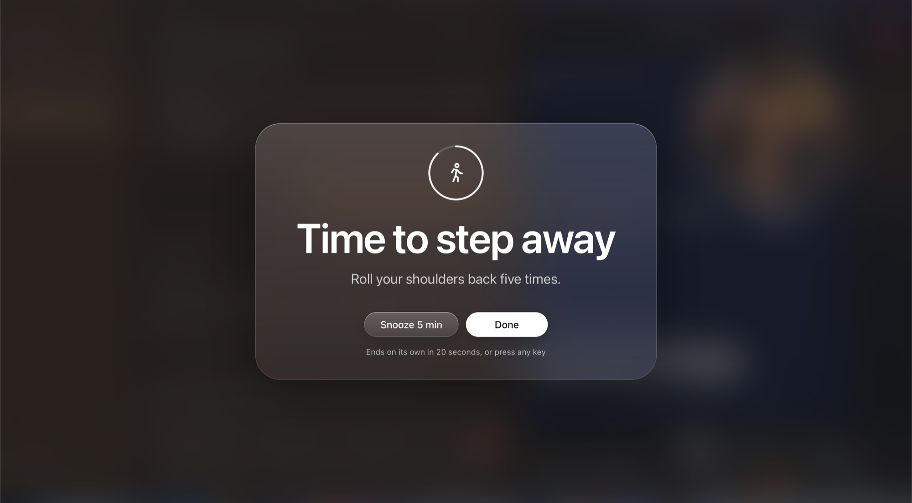
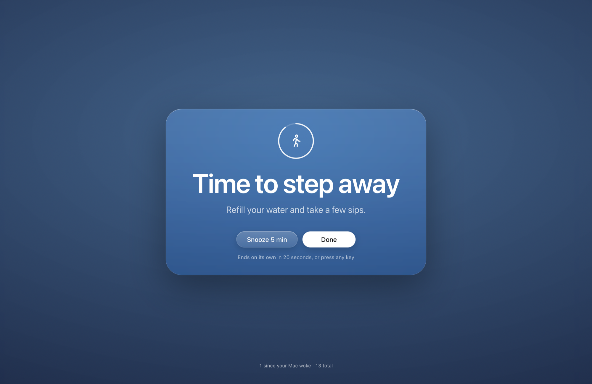
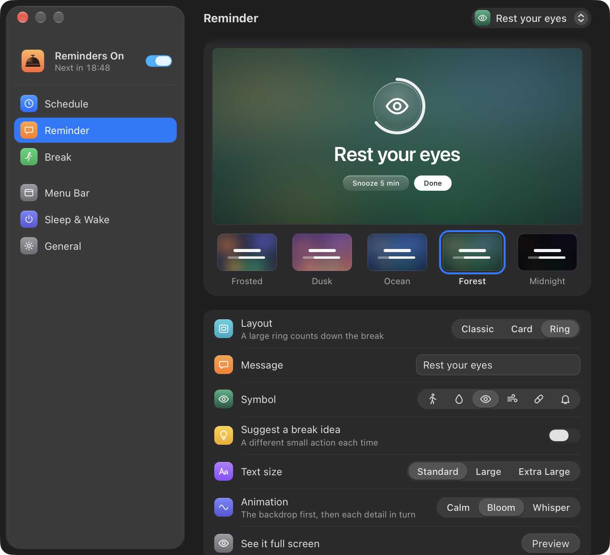
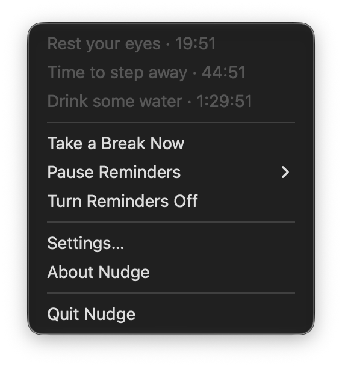
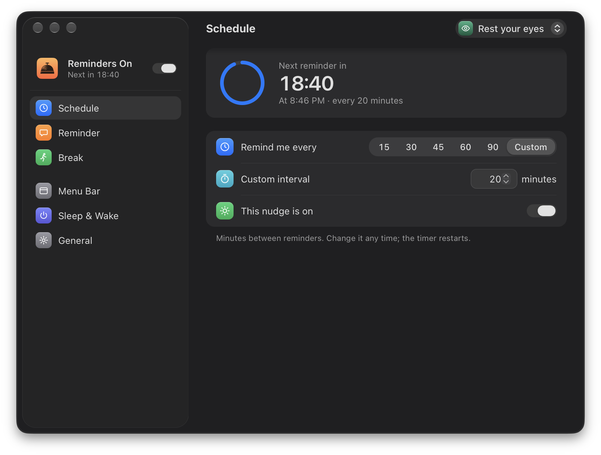
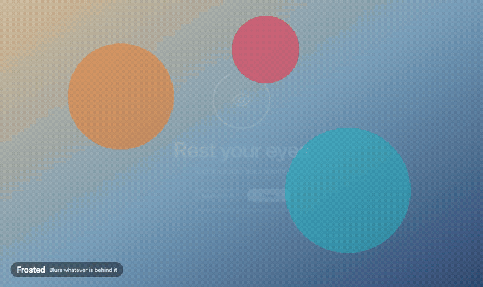
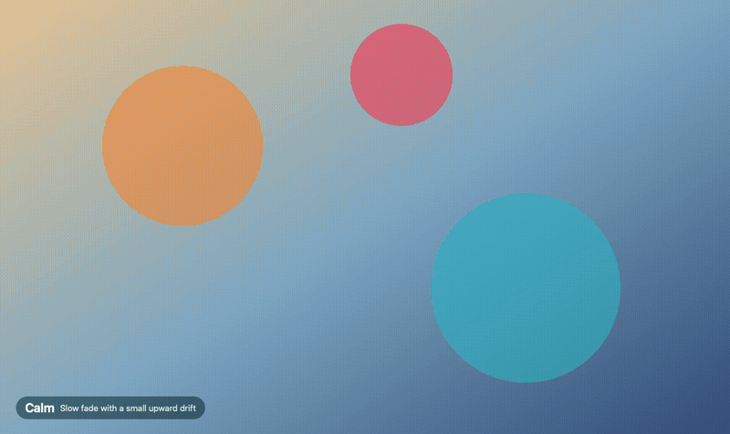

# nudge

`nudge` is a free, open source menu bar app that displays firm but gentle
reminders. It runs on macOS, Windows and Linux, sits in your menu bar or
system tray, and on a timer covers every screen with a fullscreen reminder
until you dismiss it with a click or any key.

It is useful for the Pomodoro Technique and for remembering to get up from your
desk from time to time.

<p align="center">
  
  
</p>

<p align="center">
  
</p>

<p align="center">
  
  
</p>

## Getting started

1. On an Apple silicon Mac, download the zip from the
   [latest release](https://github.com/weskcode/nudge/releases/latest), unzip
   it and move `Nudge.app` to Applications. The app is signed and notarized
   and needs macOS 11 or later (on macOS 11 and 12, with Safari kept up to
   date); it has been tested on macOS 27. On Windows,
   Linux or an Intel Mac, build it yourself (see
   [Building from source](#building-from-source)).
2. Click the Nudge icon in the menu bar. The menu shows how long until the
   next reminder and has Take a Break Now, Pause Reminders and Settings.
3. In Settings, pick how often to be reminded on the Schedule page and how the
   reminder looks on the Reminder page. Changes apply right away.
4. On a Mac, allow Input Monitoring if you want any key to close the reminder
   (see [Permissions](#permissions-macos)).

## Features

- Menu bar / system tray icon: click it for the menu with a live countdown,
  Take a Break Now, Pause Reminders (30 minutes, 1 hour, 2 hours), on/off,
  Settings and About
- Full screen reminder over every connected display that stays visible over
  fullscreen apps and workspaces. On macOS the Frosted style shows a blur of
  what is behind it
- Click, press Done, or press any key to dismiss; optional Snooze button
- Interval presets of 15/30/45/60/90 minutes plus a custom value, applied live
- Up to 8 nudges, each with its own message, interval, symbol, look and
  break settings. The pop-up at the top of Settings picks the one to edit and
  adds or deletes nudges. The menu shows a countdown line for each, and nudges
  that come due within a minute of each other share one reminder, with the
  others listed under "Also now"
- Settings persist between runs and follow light and dark mode. They are
  saved to `config.json` in the `nudge` folder of your user config
  directory (`~/Library/Application Support/nudge/` on macOS)

### Make it yours

Options chosen to keep reminders noticeable, kind and low friction, which
matters most if you have ADHD or tend to hyperfocus:

- A symbol for each nudge: walking figure, water drop, eye, breath, pill or
  bell
- Your own message, plus an optional break idea that changes every time
  (refill your water, jot down where you left off) so the reminder does not
  fade into the background
- Five reminder styles (Frosted, Dusk, Ocean, Forest, Midnight) and three text
  sizes, with a Preview button
- Three reminder layouts: Classic (text on the backdrop), Card (a glass panel)
  and Ring (a large ring around the icon that counts down the break when a
  break length is set)
- Three animations for how the reminder fades in and out: Calm (a slow fade
  with a small drift up), Bloom (the backdrop first, then each detail in turn)
  and Whisper (a short fade, nothing moves). With Reduce Motion on, the
  reminder just appears
- Break length: the reminder can close by itself after 20 seconds to 10
  minutes, with a ring that shows the time left
- Snooze length (or no snooze button at all)
- Sound: Chime, macOS system sounds, or none
- Time left in the menu bar: never, only in the last 5 minutes as a heads-up,
  or always (macOS and Linux)
- After waking from sleep: re-enable reminders, restart the timer
- Open at login

<p align="center">
  
</p>

<p align="center">
  
</p>

## Building from source

Requires Node, npm and the Rust toolchain.

```
npm install
npm run tauri dev     # run in development
npm run build         # produce an installer/binary in src-tauri/target
npm run install:app   # build a release bundle and install/relaunch /Applications/Nudge.app (macOS)
```

`install:app` signs the app with the first "Developer ID Application"
certificate in your keychain (override with `APPLE_SIGNING_IDENTITY`). A
stable signature lets macOS remember the Input Monitoring permission across
updates. Without a certificate the app is ad-hoc signed.

Debug builds also read `NUDGE_TEST_DATA_DIR`, which replaces the `nudge`
config folder (settings and diagnostics) so a test copy never touches real
files, and `NUDGE_DIAGNOSTICS_TEST` set to `stall`, `panic` or `quit`, which
makes that copy freeze its main thread for 8 seconds, panic on a background
thread or quit, a few seconds after diagnostics start. Release builds ignore
both.

Published releases are built with `sh scripts/build-release.sh`. It builds
the signed app from a clean copy of the current commit, removes home folder
paths from the binary and strips it. Notarizing is a separate step.

## Permissions (macOS)

To close the reminder with any key while another app is frontmost, Nudge
needs Input Monitoring (System Settings > Privacy & Security > Input
Monitoring). Without it, the reminder still closes with a click, the Done
button, or a key typed while the reminder has focus. Open at login installs a
LaunchAgent in `~/Library/LaunchAgents`.

## Diagnostics

Nudge keeps a small record of how it has been running on your computer, so you
can see whether it panicked, froze or ended without a normal quit. It is on by
default and stays on your computer. Nothing is sent anywhere.

Settings > General shows three counts over the last 20 launches:

- Panics: a panic the app observed. One on a background thread does not end the
  app.
- UI stalls: the app did not respond for 5 seconds or more, noticed by a
  separate watcher thread.
- Unclean exits: a launch that never recorded a normal quit. A crash, a force
  quit and a power loss all look like this, so the cause is unknown. On macOS,
  a logout, restart, shutdown or Quit from another app is recorded as a normal
  quit when the system asks Nudge to quit. On Windows, a logout, restart or
  shutdown is recorded the same way. A launch still counts as unclean if the
  record cannot be written in time.

Review diagnostics shows the exact text that would be shared, and Copy report
copies that text. Whether to send it to anyone is up to you.

The record holds counts, fixed step names such as "saving settings" and coarse
durations. A freeze while Nudge is quitting is named "quitting". The record holds
no reminder text, file names or paths, exact times, device identifiers or panic
messages, and the report is rebuilt from those numbers each time rather than
read back as text. The only version text it keeps is three plain numbers such as
`1.0.7`; anything else found in the file shows as `unknown`. The record is a
few kilobytes in a `diagnostics` folder in the `nudge` folder of your user
config directory. Deleting that folder removes the record. Quit Nudge before
you delete it: on Windows the folder cannot be removed while Nudge has it open.
On macOS and Linux, a folder deleted while Nudge is recording is recreated at the
next beat as a new launch, and the old launch's counts and events are not kept.
If only the lock file is deleted, the current launch keeps its record.
One case is not fully covered: if the lock file is deleted while the final write
for a switched-off launch is still pending, that launch may later be counted as
unclean.

The choice to keep diagnostics off is also kept in `diagnostics.off`, beside the
folder, so deleting the folder does not turn recording back on. Turning the
setting on removes both copies, and deleting the whole `nudge` folder removes
both as well.

Turn off Keep local diagnostics to stop recording. Nudge closes the current
launch with one last write, which keeps the counts and timings gathered before
you turned it off. After that nothing new is written, including after a restart,
and what was already kept stays viewable until you delete it. If that last write
fails, Settings says the last record isn't saved yet. Nudge keeps its hold on
the record, collects nothing new and tries again every 10 seconds, so a second
copy of Nudge does not count the launch as unclean while this one is still
running. If the choice itself can't be saved, recording stays off until Nudge
quits.

If the saved record can't be read, or is not one this version of Nudge
understands, Nudge leaves the file exactly as it is and does not record. It
never renames, copies or replaces it, and Settings and the report say so.
To start over, quit Nudge and delete the `diagnostics` folder.

A second copy of Nudge does not record while another one is running. A panic
that ends the app within about a second of happening can be missed, and a
normal quit that cannot be written in time counts as unclean.

## Platform notes

- macOS: the reminder panel behaves like a native HUD, joining all workspaces
  and floating above fullscreen apps
- Windows and Linux: the reminder is a fullscreen always-on-top window
- Wake-from-sleep detection works on macOS and Linux

## Credits

`nudge` is inspired by and modeled on
[remindful](https://github.com/brettferdosi/remindful) by
[Brett Gutstein](https://github.com/brettferdosi), a macOS app that did it first.
Thank you for the idea and the design. `remindful` is a Swift app for macOS;
`nudge` was written from scratch in Rust with Tauri so it also runs on Windows
and Linux. The product behavior, the tray toggle, the countdown menu and the
full-screen reminder pattern all come from `remindful`.

## Security

To report a security problem, see [SECURITY.md](SECURITY.md).

## License

MIT. The upstream notice for `remindful`, whose design inspired this app, is
preserved in `LICENSE`.
